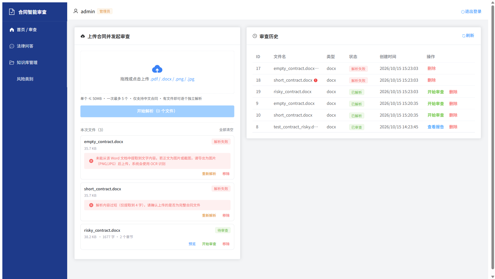
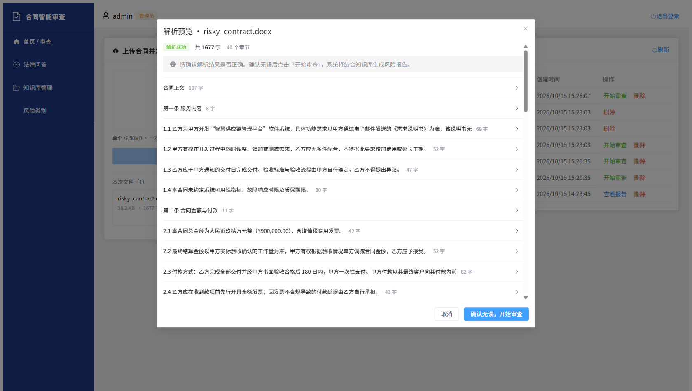
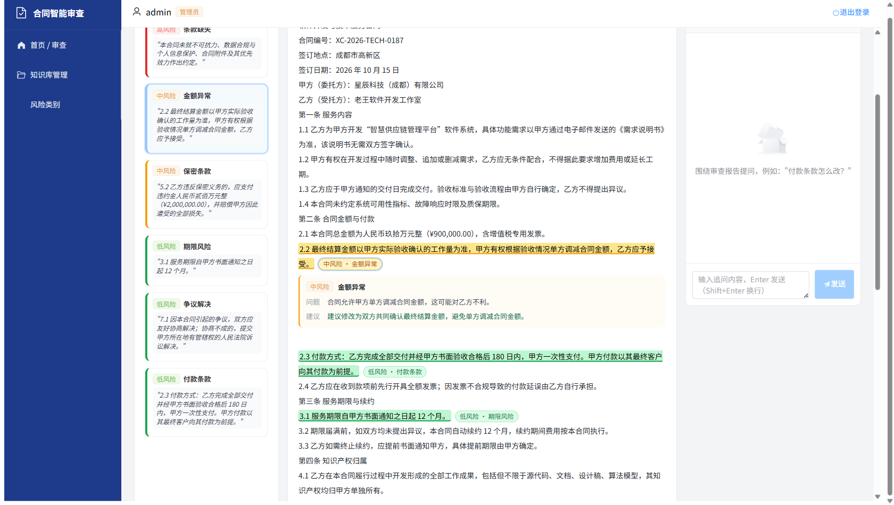
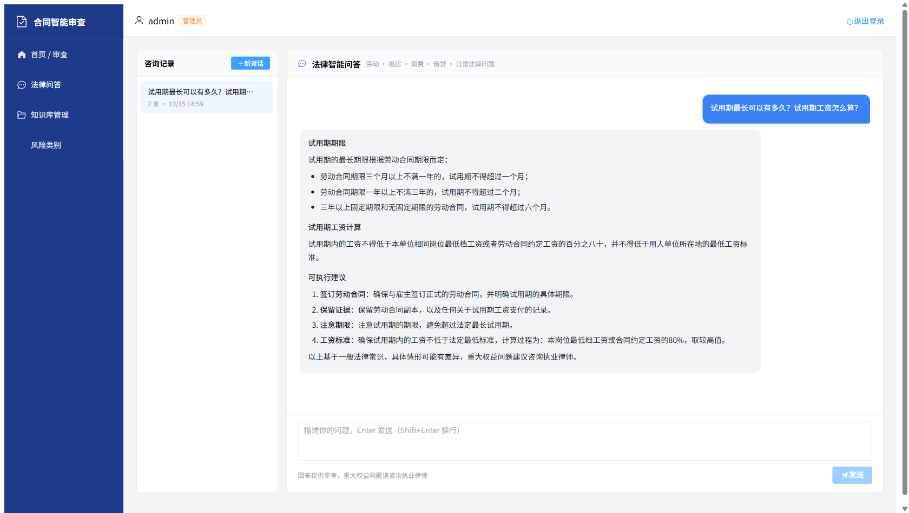

# 合同智能审查系统（Contract Review System）

基于 **RAG + 多模态解析 + 大模型对话** 的一体化合同智能审查平台。上传合同（PDF / Word / 扫描件），系统自动解析结构、结合知识库检索证据、生成结构化风险审查报告，并支持围绕报告的多轮流式追问。管理端可维护 RAG 知识库与风险类别体系。

> 对应产品需求文档：`prd-contract-review.html`（PRD v1.1）

## 功能特性

| 模块 | 说明 |
|---|---|
| 合同上传与多模态解析 | 支持 PDF（pdfplumber）/ Word（python-docx）/ 图片扫描件（PaddleOCR，可选安装），输出结构化章节与字符级定位 |
| RAG 知识库 | 管理员上传审查指引/模板/判例/法规，自动条款级切块 → 向量化 → 入库（ChromaDB），报告风险项附带可溯源依据 |
| 智能审查报告 | 9 个审查维度独立检索 → LLM 结构化输出（整体风险 + 风险项：等级/原文片段/问题/修改建议/正面发现） |
| 对话追问 | 围绕审查报告的 WebSocket 流式多轮对话，自动携带报告摘要与知识库检索证据，历史持久化 |
| 管理后台 | 知识文档上传/删除（同步清理向量库）、风险类别增删（至少保留 1 个，历史报告类别名快照不受影响） |
| 中文检测 | 自动识别非中文合同并阻断（MVP 明确仅支持中文） |
| 法律智能问答 | 独立于合同审查的日常法律咨询页面：多会话管理、常见问题快捷入口、WebSocket 流式回答 |

## 界面预览

| 批量上传与解析异常提示 | 解析结果预览确认 |
|:---:|:---:|
|  |  |
| **审查报告（风险就地批注）** | **法律智能问答** |
|  |  |

## 技术栈

| 层 | 技术 |
|---|---|
| 前端 | Vue 3（JavaScript）· Vite · Element Plus · Pinia · Vue Router 4 · Axios |
| 后端 | FastAPI · SQLAlchemy 2.0（async）· Pydantic v2 · JWT 认证 |
| RAG | ChromaDB（embedded，本地持久化）· SiliconFlow bge-m3 Embedding（1024 维） |
| 大模型 | SiliconFlow / 豆包 / 通义 / OpenAI（OpenAI 兼容协议，`.env` 一键切换） |
| 数据库 | MySQL 8.x（utf8mb4） |
| 部署 | Docker Compose（含 ChromaDB standalone 生产形态）或本地直跑 |

## 项目结构

```
contract-review-system/
├── docker-compose.yml          # 完整编排（mysql/redis/chromadb/backend/worker/frontend）
├── backend/
│   ├── app/
│   │   ├── main.py             # FastAPI 入口（lifespan 建表 + seed 默认数据）
│   │   ├── config.py           # pydantic-settings 配置（.env 驱动）
│   │   ├── core/               # database / security(JWT+RBAC) / dependencies / exceptions
│   │   ├── models/             # 7 张表 ORM：users/contracts/reviews/risk_items/
│   │   │                       #   conversations/messages/risk_categories/knowledge_docs
│   │   ├── schemas/            # Pydantic 请求/响应模型
│   │   ├── routers/            # auth / contracts / reviews / chat(含WebSocket) / admin
│   │   ├── services/           # 业务逻辑层
│   │   ├── rag/                # embedding / vectorstore / chunker / retriever / review_chain
│   │   ├── llm/                # Provider 抽象（OpenAI 兼容实现 + mock）
│   │   └── parsers/            # pdf / docx / image(OCR) 解析器 + 工厂
│   ├── tests/                  # 端到端测试脚本 + seed 工具
│   ├── requirements.txt
│   └── Dockerfile
├── frontend/
│   └── src/
│       ├── api/                # Axios 封装（JWT 拦截器）+ 各资源 API
│       ├── stores/             # Pinia（会话持久化 localStorage）
│       ├── router/             # 路由 + 登录/角色守卫
│       ├── views/              # Login / Home / ReviewReport(三栏) / admin/*
│       └── components/         # ChatPanel（WebSocket 流式对话）
└── data/                       # 运行时数据（上传文件，不入库）
```

## 快速开始（本地开发）

### 环境要求

- Python 3.11+
- Node.js 18+
- MySQL 8.x（本地运行）
- （可选）Docker + Docker Compose

### 1. 初始化数据库

```sql
CREATE DATABASE contract_review CHARACTER SET utf8mb4 COLLATE utf8mb4_unicode_ci;
```

### 2. 配置后端

```powershell
cd backend
cp .env.example .env    # 编辑 .env 填入你的 LLM / Embedding API Key
pip install -r requirements.txt
python tests/seed_db.py     # 初始化默认账号与 9 个风险类别（幂等）
python tests/migrate_db.py  # 补齐后加的字段（幂等；已建过库的环境需要执行）
uvicorn app.main:app --port 8000
```

### 3. 启动前端

```powershell
cd frontend
npm install
npm run dev    # http://localhost:5173
```

### 4. 登录

| 账号 | 密码 | 角色 |
|---|---|---|
| admin | admin123 | 管理员（可访问知识库/类别管理） |
| user | user123 | 普通用户 |

> 开发环境无 API Key 时，可在 `.env` 中设置 `LLM_PROVIDER=mock` 体验完整流程（返回模拟报告）。

## 模型配置

所有主流供应商均走 OpenAI 兼容协议，改 `.env` 三个变量即可切换：

| 供应商 | LLM_BASE_URL | 模型示例 |
|---|---|---|
| 硅基流动（默认） | `https://api.siliconflow.cn/v1` | `Qwen/Qwen2.5-7B-Instruct`（免费）/ `deepseek-ai/DeepSeek-V3` |
| 阿里通义 | `https://dashscope.aliyuncs.com/compatible-mode/v1` | `qwen-plus` |
| 字节豆包 | `https://ark.cn-beijing.volces.com/api/v3` | `doubao-pro-32k` |
| OpenAI | `https://api.openai.com/v1` | `gpt-4o-mini` |

Embedding 默认使用硅基流动 `BAAI/bge-m3`（免费、1024 维、中文效果好）。切换 Embedding 供应商会改变向量维度，需清空 `data/chroma` 重建。

## 端到端测试

后端服务运行中时执行（按顺序）：

```powershell
cd backend
python tests/make_test_contract.py   # 生成测试合同素材
python tests/test_review_e2e.py      # 上传→审查→报告
python tests/test_chat_e2e.py        # WebSocket 流式对话
python tests/test_admin_e2e.py       # 知识库 + 类别管理
```

## Docker Compose 部署

`docker-compose.yml` 已包含完整生产形态编排（MySQL + Redis + ChromaDB standalone + backend + Celery worker + frontend/Nginx）：

```powershell
docker compose up -d
```

> 注意：Celery 异步为预留形态，当前业务代码为同步执行模式，MVP 本地开发无需 Redis。

## 安全说明

- 所有密钥通过 `backend/.env` 注入，已在 `.gitignore` 中排除，**切勿提交真实密钥**
- 生产部署前务必更换 `JWT_SECRET_KEY`、关闭 `DEBUG`、为 MySQL 设置强密码
- 前端 `.env` 仅存放非敏感的 API 地址

## API 概览

统一前缀 `/api`，认证头 `Authorization: Bearer <token>`。

| 分组 | 端点 |
|---|---|
| 认证 | `POST /api/auth/login` · `POST /api/auth/register` · `GET /api/auth/me` |
| 合同 | `POST /api/contracts/upload` · `GET /api/contracts` · `GET/DELETE /api/contracts/{id}` |
| 审查 | `POST /api/reviews` · `GET /api/reviews/{id}` · `POST /api/reviews/{id}/retry` · `GET /api/reviews/by-contract/{contract_id}` |
| 对话 | `GET /api/chat/conversations/{review_id}` · `GET .../messages` · `WS /ws/chat/{conv_id}?token=<jwt>` |
| 法律问答 | `POST/GET /api/assistant/sessions` · `GET/POST /api/assistant/sessions/{id}/messages` · `DELETE .../{id}` · `WS /ws/assistant/{session_id}?token=<jwt>` |
| 管理 | `POST /api/admin/knowledge/upload` · `GET/DELETE /api/admin/knowledge/{id}` · `GET/POST/DELETE /api/admin/categories` |
| 健康 | `GET /api/health` |

## License

MIT
